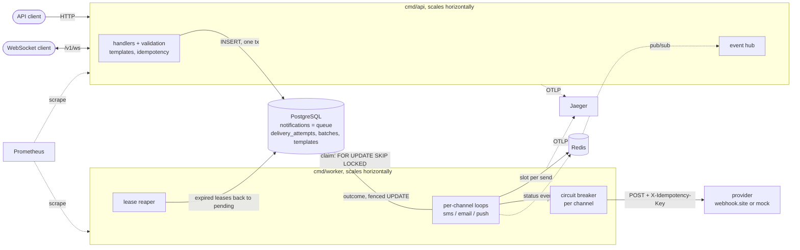
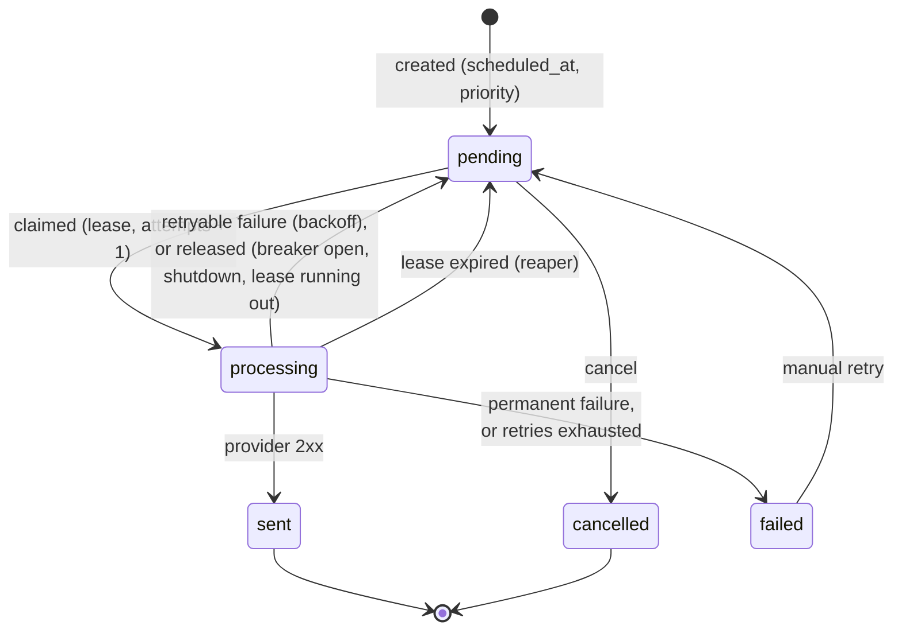

# Event-Driven Notification System

[](https://github.com/umutsahin222/insider/actions/workflows/ci.yml)

A Go service that accepts SMS, email and push notifications over HTTP, queues them durably, and
delivers them through an external provider at **at most 100 messages per second per channel**,
with priorities, scheduling, idempotency, smart retries, a circuit breaker, live status over
WebSocket, Prometheus metrics and OpenTelemetry traces.

- **One command:** `docker compose up --build` starts everything, including a mock provider, so
  it runs offline.
- **Contract:** [`api/openapi.yaml`](api/openapi.yaml) (OpenAPI 3.1, linted in CI).
- **Decisions:** ten short ADRs in [`docs/adr/`](docs/adr/).
- **How it was built with Claude Code:** [`docs/ai-workflow.md`](docs/ai-workflow.md).

## Contents
- [Quick start](#quick-start)
- [Requirements coverage](#requirements-coverage)
- [Architecture](#architecture)
- [API examples](#api-examples)
- [Delivery and retry design](#delivery-and-retry-design)
- [Observability](#observability)
- [Configuration](#configuration)
- [Using webhook.site as the provider](#using-webhooksite-as-the-provider)
- [Development](#development)
- [Project layout](#project-layout)
- [Limits and next steps](#limits-and-next-steps)

## Quick start

Requirements: Docker with Compose v2. Go 1.27 is only needed to run the tests outside Docker.

```bash
docker compose up --build        # or: make up  (background, returns when healthy)
make smoke                       # end-to-end checks against the running stack
```

Plain `docker-compose up` works too: Compose builds the image on first start.

| URL | What |
|---|---|
| http://localhost:8080 | API (`/v1/...`, `/healthz`, `/readyz`, `/metrics`) |
| http://localhost:8080/docs | Interactive API docs (Swagger UI over `/openapi.yaml`) |
| http://localhost:16686 | Jaeger: traces from API request to provider call |
| http://localhost:9090 | Prometheus: scrapes the API and every worker replica, with alert rules |
| http://localhost:8090/stats | Mock provider: calls accepted, failures injected, and the busiest second per channel (`peak_per_second`) |

The mock provider fails 10% of calls on purpose so retries are visible. Every host port can be
changed with an environment variable (`API_PORT`, `JAEGER_UI_PORT`, `PROMETHEUS_PORT`,
`MOCKPROVIDER_PORT`). Postgres and Redis publish no host ports, so they never clash with local
databases.

```bash
docker compose up -d --scale worker=3   # more workers; the rate limit still holds across them
FAILURE_RATE=0.3 docker compose up -d mockprovider   # make the provider flakier
make down                                # stop and delete volumes
```

## Requirements coverage

| Requirement | How | Where |
|---|---|---|
| Create with recipient, channel, content, priority | `POST /v1/notifications` | [`httpapi`](internal/httpapi), [`domain`](internal/domain) |
| Batch creation up to 1000 | `POST /v1/notifications/batch`, one transaction, all-or-nothing with indexed errors (`items[3].recipient`) | [ADR-004](docs/adr/004-api-conventions.md) |
| Query by ID or batch ID | `GET /v1/notifications/{id}` (with every delivery attempt), `GET /v1/batches/{id}` (status counts) | |
| Cancel pending | `POST /v1/notifications/{id}/cancel`, `POST /v1/batches/{id}/cancel`; conditional UPDATE, `409` if no longer pending | |
| List with filters and pagination | `GET /v1/notifications?status=&channel=&batch_id=&from=&to=&limit=&cursor=`, keyset pagination | |
| Asynchronous queue workers | Postgres is the queue: `FOR UPDATE SKIP LOCKED` claims, leases, a reaper | [ADR-001](docs/adr/001-postgres-as-queue.md), [ADR-005](docs/adr/005-lease-fencing-and-db-clock.md) |
| 100 msg/s per channel | GCRA slot reservation in Redis Lua, shared by all worker replicas: never more than 100 sends in any 1-second window | [ADR-003](docs/adr/003-rate-limiting.md) |
| Priority queue | Claims order by `priority, next_attempt_at` | ADR-001 |
| Content validation | E.164 phone numbers, email addresses, push tokens; 160 / 10 000 / 256 characters; all errors reported at once | [`validation.go`](internal/domain/validation.go) |
| Idempotency | `Idempotency-Key` on single and batch creates; replay returns `200`, reuse with a different body returns `422` | [ADR-006](docs/adr/006-idempotency-fingerprints-and-batch-keys.md) |
| Delivery and retry logic | Classified outcomes, exponential backoff with full jitter, `Retry-After`, circuit breaker, dead letter plus manual retry | [ADR-002](docs/adr/002-delivery-and-retry.md) |
| Metrics (queue depth, success and failure rates, latency) | Prometheus `/metrics` on API and workers, plus `GET /v1/stats` | [ADR-007](docs/adr/007-observability.md) |
| Structured logs with correlation IDs | `slog` JSON with `correlation_id`, `notification_id`, `trace_id` from API to worker to provider | ADR-007 |
| Health checks | `/healthz` (liveness), `/readyz` (Postgres and Redis) | |
| **Bonus:** failure handling | Retries, breaker, lease fencing, reaper, dead letter, manual retry | ADR-002, ADR-005 |
| **Bonus:** scheduled notifications | `scheduled_at` (up to 30 days ahead) | |
| **Bonus:** templates | `POST /v1/templates`, rendered at creation from a safe subset of `text/template` | [ADR-009](docs/adr/009-templates.md) |
| **Bonus:** WebSocket updates | `GET /v1/ws?notification_id=…` or `?batch_id=…` | [ADR-008](docs/adr/008-status-events-and-websocket.md) |
| **Bonus:** distributed tracing | OpenTelemetry API → worker → provider, viewable in Jaeger | ADR-007 |
| **Bonus:** CI | GitHub Actions: lint, unit + integration tests with `-race`, compose e2e with 1 and 3 workers | [ADR-010](docs/adr/010-packaging-and-ci.md) |
| Deliverables | OpenAPI spec, versioned migrations ([`migrations/`](migrations)), `make test`, `docker compose up` | |

## Architecture



**Why Postgres as the queue, not Kafka or RabbitMQ?** The notification row is both the record and
the unit of work. Accepting a request is a single transaction, so a message can never be stored
but not queued, or queued but not stored, and no outbox is needed. Priority, scheduled delivery
and retry backoff all fall out of one index ordered by `priority, next_attempt_at`. Cancellation
and status queries read the same row the workers update. The limit is write throughput of a single
primary: comfortably thousands of messages per second, far above the 300/s the provider limits
allow. [ADR-001](docs/adr/001-postgres-as-queue.md) records the trade-off and the migration path
to a log-based broker.

**Lifecycle of a notification.** Every transition is a conditional `UPDATE … WHERE status = …`,
and transitions out of `processing` are additionally fenced on the attempt number, so a stale
worker can never overwrite a newer attempt's result.



**Key decisions** (one ADR each, all short):

| ADR | Decision |
|---|---|
| [001](docs/adr/001-postgres-as-queue.md) | Postgres as source of truth and queue; Redis only for rate limiting and events |
| [002](docs/adr/002-delivery-and-retry.md) | Outcome classification, backoff with full jitter, ratio-based circuit breaker, dead letter and manual retry |
| [003](docs/adr/003-rate-limiting.md) | Distributed GCRA slot reservation in Redis Lua on the Redis clock; fails closed |
| [004](docs/adr/004-api-conventions.md) | RFC 9457 errors, all-or-nothing batches, keyset pagination, correlation IDs |
| [005](docs/adr/005-lease-fencing-and-db-clock.md) | `attempts` as fencing token; the database clock is the only queue clock; send deadline per claimed row |
| [006](docs/adr/006-idempotency-fingerprints-and-batch-keys.md) | Request fingerprints distinguish an idempotent replay from a reused key |
| [007](docs/adr/007-observability.md) | Prometheus with per-binary registries, OpenTelemetry without globals, `/v1/stats` |
| [008](docs/adr/008-status-events-and-websocket.md) | Redis pub/sub as a hint channel; WebSocket = subscribe, snapshot, live |
| [009](docs/adr/009-templates.md) | Render at creation, validate the result, restricted template language |
| [010](docs/adr/010-packaging-and-ci.md) | One distroless image, compose with health-ordered start-up, three-job CI |

## API examples

The full contract with every field, error and example is [`api/openapi.yaml`](api/openapi.yaml).
The running API serves it at `/openapi.yaml` and renders it at http://localhost:8080/docs, where
every request can be tried from the browser.
Errors are RFC 9457 `application/problem+json` with per-field details. Every response carries
`X-Correlation-ID`; send your own to follow a request through logs.

**Create a notification**

```bash
curl -s localhost:8080/v1/notifications \
  -H 'Content-Type: application/json' \
  -H 'Idempotency-Key: order-1234-shipped' \
  -d '{"channel":"sms","recipient":"+905551234567","content":"Your order has shipped","priority":"high"}'
```

```json
{"id":"01a1f4…","channel":"sms","recipient":"+905551234567","content":"Your order has shipped",
 "priority":"high","status":"pending","attempts":0,"max_attempts":5,"correlation_id":"…", …}
```

Sending the same request again with the same key returns `200` and the same notification, with
the header `Idempotent-Replayed: true`. The same key with a different body is a `422`.

**Validation errors** list every problem at once:

```bash
curl -s localhost:8080/v1/notifications -H 'Content-Type: application/json' \
  -d '{"channel":"sms","recipient":"12345","content":""}'
```

```json
{"type":"about:blank","title":"Validation failed","status":422,"correlation_id":"…",
 "errors":[{"field":"recipient","message":"must be an E.164 phone number, e.g. +905551234567"},
           {"field":"content","message":"is required"}]}
```

**Schedule for later** (any time up to 30 days ahead; on macOS use `date -u -v+10M …`):

```bash
curl -s localhost:8080/v1/notifications -H 'Content-Type: application/json' \
  -d '{"channel":"email","recipient":"ada@example.com","content":"Your trial ends tomorrow",
       "scheduled_at":"'"$(date -u -d '+10 minutes' +%Y-%m-%dT%H:%M:%SZ)"'"}'
```

**Templates**

```bash
curl -s localhost:8080/v1/templates -H 'Content-Type: application/json' \
  -d '{"name":"otp","channel":"sms","body":"Hi {{.name}}, your code is {{.code}}{{if eq .tier \"gold\"}} (priority support){{end}}"}'

curl -s localhost:8080/v1/notifications -H 'Content-Type: application/json' \
  -d '{"channel":"sms","recipient":"+905551234567",
       "template":{"name":"otp","variables":{"name":"Ada","code":"4242","tier":"gold"}}}'
# -> "content":"Hi Ada, your code is 4242 (priority support)"
```

The rendered text is validated like literal content (e.g. 160 characters for SMS). Every
variable a template references must be supplied. Templates are a deliberately small subset of Go
`text/template` (variables, `if`/`else`/`with`, comparisons): `range`, recursion and formatting
functions are rejected so rendering stays cheap ([ADR-009](docs/adr/009-templates.md)).

**Batch of up to 1000**, all-or-nothing, idempotent with its own key:

```bash
curl -s localhost:8080/v1/notifications/batch -H 'Content-Type: application/json' \
  -H 'Idempotency-Key: flash-sale-2026-11-19' \
  -d '{"items":[
        {"channel":"push","recipient":"device-token-1","content":"Flash sale: 50% off","priority":"high"},
        {"channel":"email","recipient":"ada@example.com","content":"Flash sale: 50% off"},
        {"channel":"sms","recipient":"+905551234567","content":"Flash sale: 50% off","priority":"low"}]}'
```

```json
{"batch_id":"01a1f4…","count":3,"notification_ids":["…","…","…"]}
```

**Status and history**

```bash
curl -s localhost:8080/v1/notifications/{id}     # includes every delivery attempt
curl -s localhost:8080/v1/batches/{batch_id}     # counts per status
curl -s 'localhost:8080/v1/notifications?status=failed&channel=sms&from=2026-11-19T00:00:00Z&limit=50'
# next page: add &cursor=<next_cursor from the previous response>
```

**Cancel and retry**

```bash
curl -s -X POST localhost:8080/v1/notifications/{id}/cancel    # 409 unless still pending
curl -s -X POST localhost:8080/v1/batches/{batch_id}/cancel    # cancels the batch's pending items
curl -s -X POST localhost:8080/v1/notifications/{id}/retry     # dead-lettered (failed) -> pending
```

**Live status over WebSocket** (here with [websocat](https://github.com/vi/websocat)): a snapshot
first, then every transition.

```bash
websocat 'ws://localhost:8080/v1/ws?batch_id={batch_id}'
```

```json
{"notification_id":"…","batch_id":"…","status":"pending","attempts":0,"error":null,"occurred_at":"…"}
{"notification_id":"…","batch_id":"…","status":"processing","attempts":1,"error":null,"occurred_at":"…"}
{"notification_id":"…","batch_id":"…","status":"pending","attempts":1,"error":"provider responded 503 Service Unavailable","occurred_at":"…"}
{"notification_id":"…","batch_id":"…","status":"sent","attempts":2,"error":null,"occurred_at":"…"}
```

**How is delivery going right now?** No Prometheus needed:

```bash
curl -s 'localhost:8080/v1/stats?window=5m'
```

It returns, per channel, the backlog (ready, delayed, processing, by priority, and queue lag) and,
over the window, provider calls by outcome, success rate, sent and failed counts, and
p50/p95/p99 provider and end-to-end latency. All of it is computed in the database, so it covers
every worker replica.

## Delivery and retry design

The spec leaves this to the candidate. Full reasoning is in
[ADR-002](docs/adr/002-delivery-and-retry.md) and [ADR-005](docs/adr/005-lease-fencing-and-db-clock.md).

- **Classify every attempt:** `2xx` → `sent` (provider `messageId` stored). Timeouts, network
  errors, `408`, `429` and `5xx` are retryable. Any other `4xx` is permanent and fails at once:
  retrying a rejected request cannot succeed.
- **Backoff:** `min(2s · 2^(attempt-1), 5m)` with full jitter, so a provider recovering from an
  outage is not hit by a synchronised wave. `Retry-After` is honoured. Five attempts by default;
  then the notification is dead-lettered as `failed`, queryable with `?status=failed`, and can be
  re-queued with `POST /retry`.
- **Circuit breaker per channel:** opens when at least 20 calls in a 10 s window failed by 50% or
  more, or after 10 consecutive failures; probes again after 30 s. While open, workers stop
  claiming and hand claimed work back *without* using an attempt, so an outage does not burn
  every message's retries. Random failures at 30% do not open it (that was a real bug, found
  through `/v1/stats` and fixed).
- **Every attempt is audited** in `delivery_attempts` (status code, error, duration), returned by
  `GET /v1/notifications/{id}`.
- **At-least-once, fenced:** a crashed worker's lease expires and the reaper re-queues the row.
  A stalled worker that wakes up later cannot overwrite the new attempt (`attempts` is a fencing
  token). A worker never starts a send its lease might not cover. The provider receives
  `X-Idempotency-Key: <notification id>` to deduplicate the rare double send.
- **Graceful shutdown:** in-flight sends finish and are recorded; unstarted claims are released.

## Observability

- **Metrics** on `/metrics`:
  - API: `notification_queue_depth{channel,priority,state}`, `notification_queue_oldest_ready_age_seconds`,
    `http_requests_total`, `http_request_duration_seconds`, `notifications_accepted_total`,
    `websocket_connections`.
  - Workers (`:9091`): `notification_deliveries_total{channel,outcome,result}`,
    `notification_provider_request_duration_seconds`, `notification_end_to_end_latency_seconds`,
    `notification_rate_limit_wait_seconds`, `notification_releases_total{reason}`,
    `notification_circuit_breaker_state`, `notification_reaper_reclaimed_total`.
  - Labels only come from closed sets (channel, priority, outcome, route pattern), never IDs.
  - Prometheus discovers every worker replica through DNS, and ships with
    [alert rules](deploy/prometheus/alerts.yml) for queue lag, failure rate, an open breaker and
    unreadable queue stats.
- **Logs:** JSON (`log/slog`). Every request and delivery log line carries `correlation_id`
  (taken from `X-Correlation-ID` or generated) and `trace_id`/`span_id`; delivery lines also carry
  `notification_id`. The correlation ID is stored with the notification, so the worker's lines for
  every attempt share the ID of the request that created it, and it is forwarded to the provider.
- **Traces:** the API request span, the worker's span for every attempt (with a `ratelimit.wait`
  child) and the provider HTTP call form one trace, because the trace context is stored with the
  notification. Open Jaeger and search for service `notification-api`.

## Configuration

Everything is configured with environment variables and has a local-development default
([`internal/config`](internal/config/config.go)). A misconfiguration reports every bad variable
at once and the binary refuses to start.

| Variable | Default | Binary |
|---|---|---|
| `DATABASE_URL`, `REDIS_URL` | local Postgres / Redis | both |
| `HTTP_ADDR` | `:8080` (API), `:9091` (worker ops) | both |
| `LOG_LEVEL` | `info` | both |
| `OTEL_EXPORTER_OTLP_ENDPOINT`, `TRACE_SAMPLE_RATIO` | off, `1` | both |
| `SMS_MAX_LENGTH`, `EMAIL_MAX_LENGTH`, `PUSH_MAX_LENGTH` | `160`, `10000`, `256` | API |
| `MAX_BATCH_SIZE`, `MAX_ATTEMPTS`, `MAX_SCHEDULE_AHEAD` | `1000`, `5`, `720h` | API |
| `WS_ALLOWED_ORIGINS` | empty (same origin only) | API |
| `PROVIDER_URL`, `PROVIDER_TIMEOUT` | mock provider, `5s` | worker |
| `RATE_LIMIT_PER_SECOND`, `RATE_LIMIT_BURST` | `100`, `1` | worker |
| `CHANNELS`, `WORKER_CONCURRENCY`, `CLAIM_BATCH_SIZE` | all, `8`, `10` | worker |
| `LEASE_DURATION`, `REAPER_INTERVAL`, `POLL_INTERVAL` | `60s`, `10s`, `200ms` | worker |
| `RETRY_BASE`, `RETRY_MAX` | `2s`, `5m` | worker |
| `BREAKER_FAILURE_RATIO`, `BREAKER_MIN_REQUESTS`, `BREAKER_WINDOW`, `BREAKER_FAILURES`, `BREAKER_OPEN_TIMEOUT` | `0.5`, `20`, `10s`, `10`, `30s` | worker |

## Using webhook.site as the provider

1. Create a URL at [webhook.site](https://webhook.site). Under **Edit**, set the default response
   to status `202`, content type `application/json` and a body like
   `{"messageId": "3f2b8c1e-0d4a-4a8e-9a57-1c2d3e4f5a6b", "status": "accepted", "timestamp": "2026-11-19T12:00:00Z"}`.
   webhook.site's API can do the same (`POST https://webhook.site/token` with `default_status`,
   `default_content` and `default_content_type`). The worker stores `messageId` as
   `provider_message_id`. Any `2xx` counts as accepted, so an unconfigured URL (`200` with an HTML
   body) also works, just without a message ID.
2. Start the stack against it:

   ```bash
   PROVIDER_URL=https://webhook.site/<your-uuid> docker compose up --build
   ```

The worker posts `{"to", "channel", "content"}` exactly as the brief specifies, plus the headers
`X-Idempotency-Key`, `X-Correlation-ID` and `traceparent`. The image includes CA certificates, so
HTTPS providers work out of the box.

Verified live: an SMS, an email and a push sent through a real webhook.site URL arrived as
`{"to", "channel", "content"}` with all three headers, got `202`, and the configured `messageId`
was stored on each notification. Provider latency was 330–600 ms.

With latency like that, one worker's 8 loops per channel send about 8 / 0.4 s = 20 messages per
second. To use the full 100/s against a slow provider, raise `WORKER_CONCURRENCY` or scale out
workers; the limit holds either way.

A free webhook.site URL accepts only a limited number of requests in total (50 to 100, according
to its documentation) and expires after 7 days. Past the limit it answers `429`, which the worker
treats as retryable and eventually dead-letters. Use it to watch a handful of real deliveries, and
the mock provider for load.

## Development

```bash
make test-unit    # fast: unit tests only
make test         # unit + integration (testcontainers: real Postgres and Redis; Docker needed), -race
make lint         # go vet (also with the integration and acceptance build tags) + golangci-lint
make lint-api     # OpenAPI contract (Redocly, via Docker)
make migrate-up   # migrations through the compose migrate service
```

Integration tests cover what unit tests cannot:
- 10 concurrent claimers over 300 rows with no double claims;
- lease fencing against a zombie worker;
- idempotent creates with 20 concurrent callers;
- three rate-limiter instances sharing one limit, with slots spaced exactly 10.1 ms apart;
- Redis pub/sub fan-out, recovery from a killed Redis connection, and prompt hub shutdown.
CI ([`.github/workflows/ci.yml`](.github/workflows/ci.yml)) runs lint, the full test suite with
`-race`, and an end-to-end job that starts the compose stack, runs [`scripts/smoke.sh`](scripts/smoke.sh),
scales to three workers and runs it again.

## Project layout

```
cmd/
  api/             HTTP API, WebSocket, queue-depth metrics
  worker/          per-channel delivery workers, reaper, ops endpoints
  mockprovider/    local provider with configurable failure rate and latency
  healthcheck/     tiny probe for container health checks (distroless has no curl)
internal/
  domain/          model, validation, state machine, templates, idempotency (imports nothing internal)
  httpapi/         chi handlers, middleware, error mapping, WebSocket
  delivery/        worker loop, outcome classification, retry policy, circuit breaker, reaper
  store/postgres/  pgx store: notifications, work-queue operations, stats, templates
  ratelimit/       distributed rate limiter (GCRA slot reservation on Redis)
  provider/        provider HTTP client
  events/          status events over Redis pub/sub, per-process hub
  metrics/         Prometheus collectors
  observability/   slog JSON with correlation IDs, OpenTelemetry setup
  config/          environment configuration
migrations/        versioned SQL (golang-migrate)
api/openapi.yaml   API contract
docs/adr/          architecture decision records
deploy/prometheus/ scrape config and alert rules
```

Dependencies point inward: `httpapi` and `delivery` depend on `domain`; `store/postgres` implements
interfaces those packages define. There is no global state; each `main.go` wires everything
explicitly, including Prometheus registries and the tracer provider.

## Limits and next steps

- **No authentication.** The brief does not ask for it; in production the API would sit behind a
  gateway with per-tenant credentials, and the rate limit would become per tenant as well as per
  channel.
- **Throughput ceiling:** a single Postgres primary. Past several thousand messages per second the
  queue would move to a partitioned log (Kafka, or Redis Streams) with an outbox from Postgres;
  ADR-001 describes the path.
- **Retention:** `sent` notifications and attempt history grow forever; a partitioned table with
  time-based drops would bound them.
- **Per-recipient controls** (quiet hours, frequency caps, opt-out lists) would sit in the domain
  before enqueueing.
