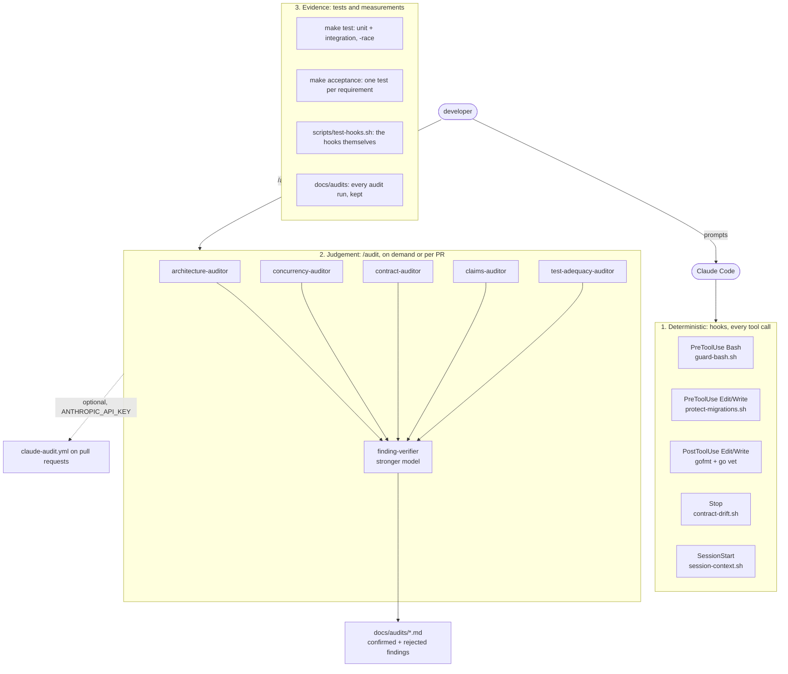

# Claude Code toolkit: guardrails, auditors and evidence

This repository was built with Claude Code. It also ships the setup that keeps Claude Code
honest when it works here. That setup turns the project's written rules (`CLAUDE.md`, the ADRs)
into three layers. Each layer catches what the previous one cannot.



## 1. Hooks: rules that must hold whatever the prompt

Hooks run on every matching tool call and decide deterministically. They live in
[`.claude/hooks/`](../.claude/hooks) and are wired in [`.claude/settings.json`](../.claude/settings.json).

| Hook | Event | What it enforces |
|---|---|---|
| `guard-bash.sh` | PreToolUse `Bash` | **Denies:** force, mirror and delete pushes; pushes of `eval/*` branches; `git reset --hard`; `git clean -f`; docker prunes; `docker rm/stop/kill` of containers outside this compose project; `rm -r` of root, home, parent or out-of-repo paths. **Asks** before any other push. |
| `protect-migrations.sh` | PreToolUse `Edit\|Write\|MultiEdit` | Denies editing a migration that already exists in `HEAD`; new migrations are fine. |
| `gofmt.sh` | PostToolUse `Edit\|Write` | `gofmt -w` and `go vet` on the edited file's package, using the file's own build tag. |
| `contract-drift.sh` | Stop | Sends Claude back once if HTTP handlers changed without `api/openapi.yaml`, or if `go vet` fails on uncommitted Go changes. |
| `session-context.sh` | SessionStart | Reports the branch, unpushed and uncommitted work, and whether the Docker daemon is reachable. |

- **Portable:** the hooks use only bash, sed, grep and git, through a shared `lib.sh`. Windows
  paths are normalised, and `.gitattributes` pins LF endings. They behave the same in Git Bash
  and on Linux CI.
- **Tested:** `scripts/test-hooks.sh` (`make test-hooks`) feeds each hook the JSON Claude Code
  sends, in 53 cases, including `contract-drift` in a throwaway repository. It runs in the CI
  lint job.
- **Generic:** rules name nothing specific to one developer's machine. Personal exceptions
  belong in the untracked `.claude/settings.local.json`.

## 2. Scoped instructions: the right rules at the right moment

Besides the root [`CLAUDE.md`](../CLAUDE.md), four directories carry their own `CLAUDE.md`, which
Claude Code loads when it works on files there:
- [`internal/store/postgres`](../internal/store/postgres/CLAUDE.md): fencing, database clock,
  the reaper exception.
- [`internal/delivery`](../internal/delivery/CLAUDE.md): send deadline, rate-limit slot,
  breaker probe.
- [`internal/httpapi`](../internal/httpapi/CLAUDE.md): contract, error mapping, metric labels.
- [`migrations`](../migrations/CLAUDE.md): never edit a committed migration.

## 3. Auditor subagents: judgement, filtered

Six subagents are defined in [`.claude/agents/`](../.claude/agents). To check what is installed,
look in that directory; current Claude Code versions have no `/agents` command. Every subagent:
- is **read-only** (`Write`, `Edit`, `NotebookEdit` and `Agent` are disallowed; Bash is used for
  `go list`, `git`, `grep` and running existing tests);
- owns **one rule family**, cites the `CLAUDE.md` rule or ADR it checks, and knows the documented
  exceptions;
- returns machine-readable findings:
  `{id, agent, rule, file, line, severity, evidence, failure_scenario}`.

| Agent | Model | Checks |
|---|---|---|
| `architecture-auditor` | sonnet, effort high | **Four mandatory checks, reported in `checks_executed`:** dependency direction (`go list`), global state (grep table), metric label cardinality (every label value traced to its source), business-rule leakage (every handler and SQL file read). |
| `concurrency-auditor` | sonnet | Fenced transitions, database clock, lease and rate-limit invariants, context-honouring I/O, goroutine lifecycle. |
| `contract-auditor` | sonnet | Routes, fields, nullability, status codes and headers against `api/openapi.yaml`; `make lint-api`. |
| `claims-auditor` | sonnet | Present-tense claims in README, ADRs and `CLAUDE.md` files (tests, metrics, env defaults, endpoints, limits) against the code. |
| `test-adequacy-auditor` | sonnet | Changed behaviour has a test that **fails without the change**, proven by reverse-applying the change in a temporary git worktree. The worktree is removed with retries for Windows file locks and never touches the main tree. |
| `finding-verifier` | opus | Skeptical second pass. It re-checks and reproduces each finding, returns CONFIRMED or REJECTED with evidence, and adjusts severity. |

**Why this shape:**
- **Narrow agents** with one rule family each give deeper passes than one general reviewer.
- **Read-only tools** make an audit safe to run at any time.
- **Fast models for breadth, a strong model for judgement:** auditors may over-report, because
  the verifier filters, and false alarms cost the developer more than a dropped finding.
- **Coverage contract:** `architecture-auditor` must prove what it covered, because an empty
  result means nothing otherwise. That rule came from a real run (see below).

## 4. Skills: procedures the developer starts

Skills live in [`.claude/skills/`](../.claude/skills). The ones with side effects can only be
started by the developer (`disable-model-invocation`).

| Skill | What it does |
|---|---|
| `/audit [diff \| all \| <range> \| <path>]` | Resolves the scope, runs the five auditors **in parallel**, checks `checks_executed`, de-duplicates, sends every finding to `finding-verifier`, and writes `docs/audits/<date>-<scope>.md` with confirmed **and** rejected findings. Changes no code. |
| `/ship` | The definition of done: lint, unit tests, integration tests with `-race`, OpenAPI lint, hook tests, smoke and acceptance when the stack is up, `/audit` on the diff, docs in the same commit, Conventional Commits. The push stays with the developer, then CI is watched. |
| `/spec-check` | Runs `make acceptance` and maps every failure to the requirement it covers, after deciding whether the **product** or the **test expectation** is wrong. |
| `/adr <title>` | The next numbered ADR (or a revision) with the repository's template, a README row, and a pointer in the affected package's `CLAUDE.md`. |

`.github/workflows/claude-audit.yml` runs the same `/audit` on pull requests with
`anthropics/claude-code-action` and posts the report as a comment. It is opt-in: without an
`ANTHROPIC_API_KEY` secret the job is skipped and nothing fails.

## 5. Evidence: what the layer actually did

Every audit run is kept in [`docs/audits/`](audits/).

| Run | Result |
|---|---|
| [`/audit all` on `main`](audits/2026-11-20-all.md) | 11 raw findings, 6 confirmed (all low: undocumented 413/403/426, `required` lists, the correlation-ID pattern, two doc claims), 5 rejected with reasons. All 6 were fixed, with tests. The verifier also found a missing regression test, which was added and mutation-checked. |
| [architecture re-check](audits/2026-11-20-architecture-recheck.md) | The first run's architecture pass covered the whole repository in 3 tool calls. Hardened with mandatory checks, it took 25 calls and found **a real bug the first run missed**: the raw HTTP method as a metric label (unbounded series). Fixed, and the test fails without the fix. |
| [planted-bug evaluation](audits/2026-11-20-planted-bug-evaluation.md) | 8 violations and 3 decoys planted blind on a local branch: **8/8 caught**, each by 2–4 auditors; 0 correctness alarms on decoys; 20/20 findings confirmed by the verifier, which also found two bugs nobody planted. The limits are stated, including a prompt-contamination issue that was then fixed. |

## 6. Using it

```text
claude                         # hooks and scoped CLAUDE.md files load automatically
/audit                         # audit your branch against origin/main
/audit all                     # periodic full audit
/ship "short description"      # all checks, audit, commit; you push
make test-hooks                # test the hooks themselves
make git-hooks                 # enable the pre-push hook (refuses eval/* branches)
```

Subagent and skill definitions are read when a session starts. After changing a file in
`.claude/agents/` or `.claude/skills/`, restart Claude Code (`/exit`, then `claude --continue`)
before relying on it. This repository learned that the hard way: a re-run in the same session
still used the old definition.
